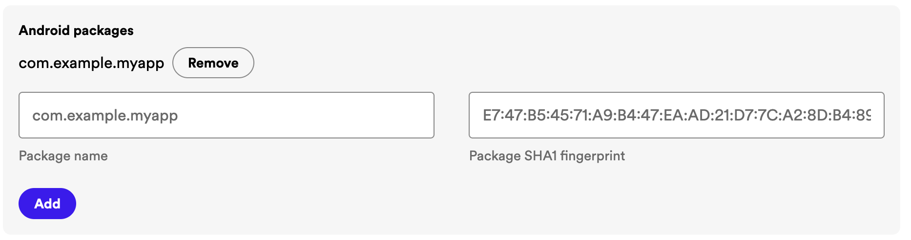

# Spotify in EveryApp

Mini-Apps (zum Beispiel ein „Song raten“-Quiz) suchen Titel über die Spotify Web API und steuern die Wiedergabe über die **installierte Spotify-Android-App**. Der Ton läuft in Spotify, nicht im WebView. Das Web Playback SDK wird nicht verwendet. `preview_url`, Audio-Features und der alte Recommendations-Endpunkt werden nicht benutzt.

Es gibt **kein Client-Secret** in diesem Repo. Die Client ID ist öffentlich und wird zur Laufzeit eingetragen. Ein leeres `expo.extra.spotifyClientId` ist der Normalfall.

## Einmalig im Spotify Dashboard

Am Computer geht das leichter als auf dem Handy: [Spotify Developer Dashboard](https://developer.spotify.com/dashboard). Die Client ID fügst du danach in EveryApp ein. Dieselben Schritte, mit den Werten der gerade laufenden App, stehen in EveryApp auf dem Startbildschirm unter **Spotify** hinter dem Knopf **Anleitung**.

1. App anlegen und **Web API** sowie **Android SDK** auswählen. Nicht das Web Playback SDK.
2. Redirect-URI exakt: `everyapp://spotify-callback`
3. **Bundle IDs** leer lassen. Das Feld ist nur für iOS. EveryApp ist vorerst nur Android.
4. Unter **Android Packages** gibt es keine eigene „SHA“-Überschrift. Zwei Felder stehen nebeneinander: links **Package name**, rechts **Package SHA1 fingerprint**, danach Add bzw. Save. So sieht die Zeile im Dashboard aus:

   

   Das Bild ist die Spotify-Oberfläche, nicht EveryApp. EveryApp ist kein offizielles Spotify-Produkt.

5. Paketname und SHA-1 müssen zur **gerade laufenden** Variante passen. Nichts raten und den Debug-Fingerabdruck nicht für die Produktions-App verwenden.
   - Development / **SrvEveryApp** (`APP_VARIANT=development`, Paket `com.everyapp.container.dev`): SHA-1 des Debug-Keystores der aktuellen SrvEveryApp-APK ist `5E:8F:16:06:2E:A3:CD:2C:4A:0D:54:78:76:BA:A6:F3:8C:AB:F6:25`. Im Dashboard-Feld steht die Form mit Doppelpunkten. Ohne Doppelpunkte ist derselbe Wert gültig.
   - Production / **EveryApp** (`com.everyapp.container`): den Paketnamen eintragen. Der SHA-1 dieser Signatur liegt nicht im Repo. Vom Signaturzertifikat oder aus den EAS-Android-Credentials dieses Builds lesen.
   - Den lokalen Debug-Keystore kannst du selbst prüfen, sobald so ein Build existiert:

     ```bash
     keytool -list -v -keystore ~/.android/debug.keystore -alias androiddebugkey -storepass android -keypass android
     ```

6. Die Client ID kopieren (32 Hex-Zeichen). Sie kommt **nicht** in den Quellcode, wenn du sie nicht als optionalen Prefill setzen willst. Ein Client Secret gibt es in diesem Repo nicht.

## In EveryApp

1. APK installieren (dieser Stand enthält Auth- und App-Remote-SDK, Redirect und Paketnamen).
2. Spotify-App auf dem Gerät installieren und mit dem Premium-Account anmelden. Einen einzelnen Track (`spotify:track:…`) abspielen geht nur mit Premium. API und SDK kosten nichts extra.
3. In EveryApp auf dem Startbildschirm **Spotify** öffnen, Client ID einfügen, speichern. Die **Anleitung** neben dem Feld zeigt Redirect-URI, Paketname und SHA-1 für diese Installation.
4. Dafür ist **kein neuer Build** nötig. Die ID liegt in den Container-Einstellungen von EveryApp, nicht im Mini-App-Repo. `login`, `connect` und `play` lesen die gespeicherte ID bei jedem Aufruf.

Ohne gespeicherte ID kommt:

`Keine Spotify Client ID hinterlegt. Bitte in den EveryApp-Einstellungen eintragen.`

### Vorrang, wenn mehrere IDs existieren

1. **EveryApp-Einstellungen** (Container, Quelle der Wahrheit)
2. `EveryAppBridge.spotify.setClientId()` einer Mini-App mit erlaubter Permission `spotify` (ebenfalls nur im Container, nicht im Mini-App-Storage)
3. Optionaler Build-Prefill: Umgebungsvariable `SPOTIFY_CLIENT_ID` oder `expo.extra.spotifyClientId` in `app.json`

`setClientId` überschreibt eine in den Einstellungen gespeicherte ID nicht. `getClientId()` liefert `source`: `settings`, `bridge`, `prefill` oder `none`.

Tokens (Access und Refresh) liegen in den privaten App-Preferences des Containers. Mini-Apps bekommen keinen Access-Token. `search`, `getMe`, `getMyPlaylists` und `getSavedTracks` rufen die Web API selbst auf und erneuern abgelaufene Tokens.

## Mini-App

In `everyapp.json`:

```json
{ "permissions": ["spotify"] }
```

Der Nutzer muss die Permission im Dialog erlauben. `spotify` ist nicht frei (anders als `media`). `EveryAppBridge.media.*` bleibt die generische Medientasten-Steuerung und startet keine Spotify-URI.

```javascript
await EveryAppBridge.spotify.login();
await EveryAppBridge.spotify.connect();
const found = await EveryAppBridge.spotify.search('gelbes u-boot', { types: ['track'], limit: 5 });
await EveryAppBridge.spotify.play(found.tracks.items[0].uri, { positionMs: 20000 });
await EveryAppBridge.spotify.pause();
```

Events: `spotify.connected`, `spotify.disconnected`, `spotify.player`, `spotify.error`.

`stop()` ist Pause plus Sprung an den Anfang. Das App-Remote-SDK hat keinen eigenen Stop-Befehl.

Weitere Beispiele stehen in der README unter „Spotify API“.

## Bibliotheken

- Auth: `com.spotify.android:auth:5.0.0` von Maven Central. Authorization Code mit PKCE (die Bibliothek tauscht den Code, Refresh-Token bleibt bei uns). Ab Auth 5 muss die Redirect-Activity im App-Manifest stehen. Das macht `plugins/withSpotify.js` für `everyapp://spotify-callback`.
- App Remote: `spotify-app-remote-release-0.8.0.aar`. Auf Maven Central gibt es nur `com.spotify.android:auth` und `auth-store`, **kein** `app-remote`-Artefakt (geprüft November 2026). Die AAR ist die offizielle Datei aus [spotify/android-sdk](https://github.com/spotify/android-sdk/blob/master/app-remote-lib/spotify-app-remote-release-0.8.0.aar). Herkunft und SHA256: `modules/expo-spotify/android/libs/SOURCE.txt`.
- Gson `2.10.1` (von App Remote benötigt, nicht in der AAR enthalten).

Wenn `com.spotify.android:auth:5.0.0` beim Gradle-Sync nicht aufgelöst wird, den Maven-Fehler festhalten und keine andere Koordinate erfinden.
